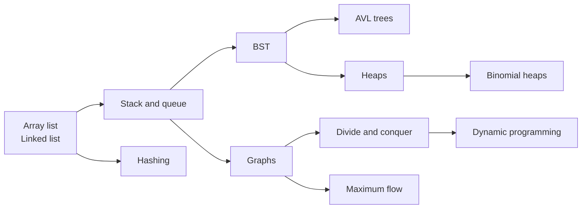
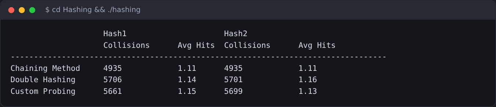
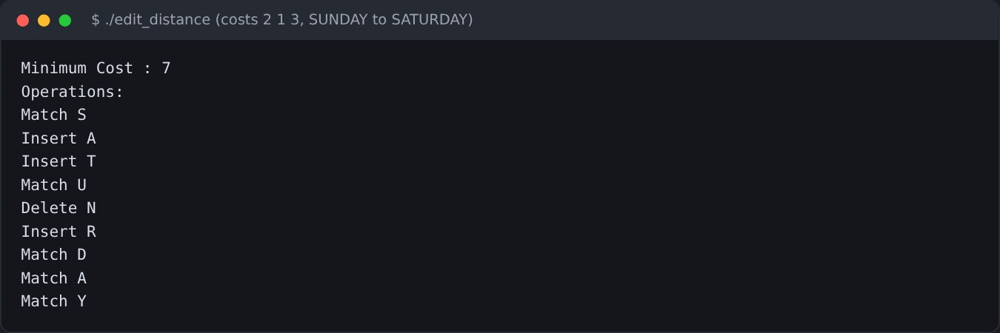
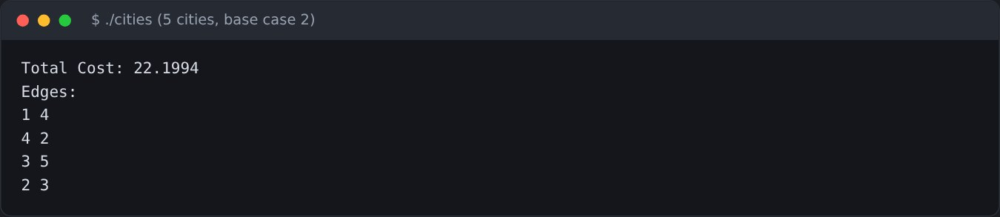
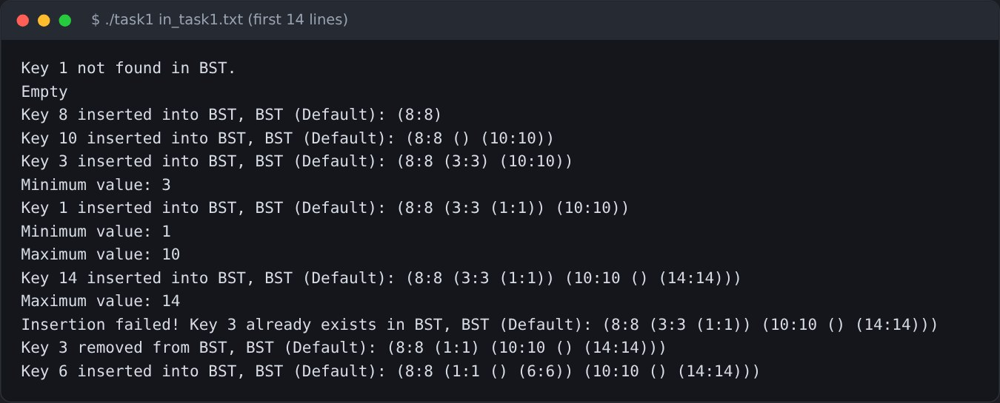
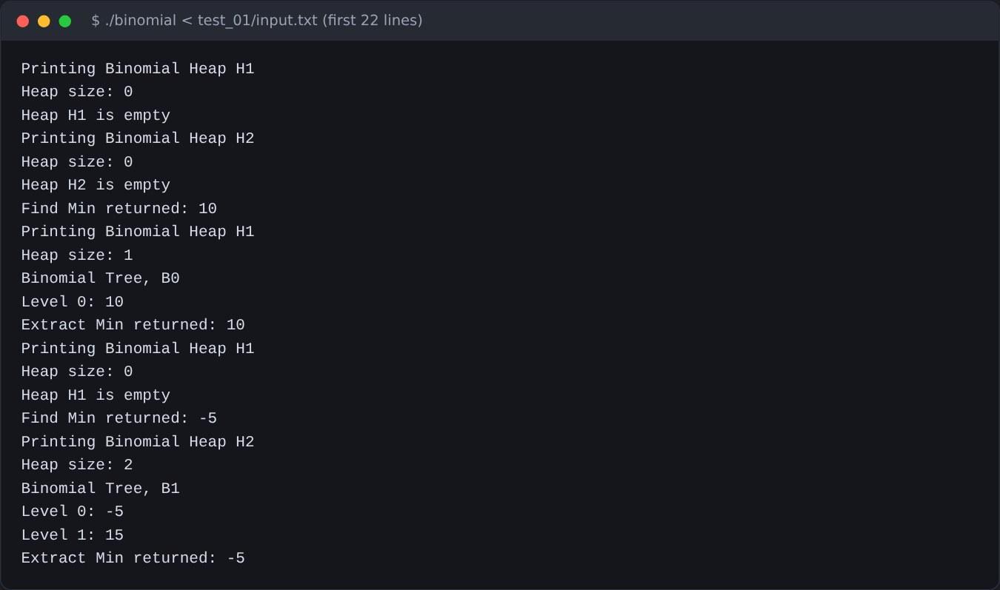
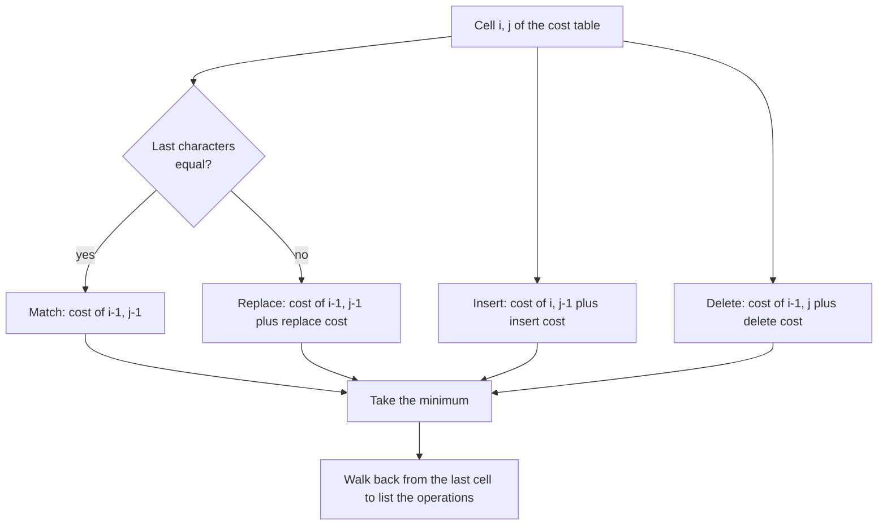
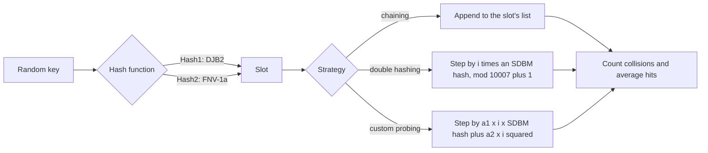
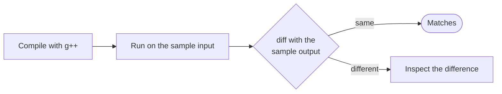

<div align="center">


# Data Structures and Algorithms

**Eleven topics of university coursework, written in C++ and C.**

Lists, stacks and queues, BSTs, AVL trees, heaps, binomial heaps, hashing,
graphs, divide and conquer, dynamic programming and maximum flow.


[Topics](#topics) · [Results](#results) · [Flows](#flows) · [Build and run](#build-and-run) · [Notes](#notes)

</div>

Each topic folder holds the assignment PDF next to the code written for it.

## At a glance

| | |
| --- | --- |
| **Topics** | 11, from array lists to maximum flow |
| **Languages** | C++17 for almost everything, C for the list assignment |
| **Build** | g++ 13 on Linux; only the AVL programs need Windows (`windows.h`) |
| **Samples** | Input and expected-output files for lists, BSTs, heaps, binomial heaps and AVL trees |
| **Checked** | The BST driver reproduces `out_task1.txt` exactly, and the binomial heap matches all ten samples apart from one punctuation mark (see Notes) |

## Contents

- [At a glance](#at-a-glance)
- [Topics](#topics)
- [Topic map](#topic-map)
- [Results](#results)
- [Flows](#flows)
- [Repository layout](#repository-layout)
- [Build and run](#build-and-run)
- [Input formats](#input-formats)
- [Sample data](#sample-data)
- [Notes](#notes)

## Topics

| Topic | Folder | What is implemented | Language |
| --- | --- | --- | --- |
| Array list and linked list | `Array List and Linked list/` | A resizable array list and a linked list with `insert`, `append`, `delete_cur`, `delete_item`, `search`, `swap_ind`, `prev`/`next`, `clear` and `print`. The array list also has `trim`, `reverse` and capacity growing and shrinking. | C |
| Stack and queue | `Stack And Queue/` | A `Queue` interface with an array-based `ArrayQueue` and a linked `ListQueue`, plus a bracket-matching syntax checker for expressions. | C++ |
| Binary search tree | `BST/` | A pointer-based BST (`listBST.hpp`) built on the `BST.hpp` interface, with two driver programs. | C++ |
| AVL trees | `AVL Trees/` | An AVL tree and an interval scheduler tree, both with timing output. | C++ (Windows) |
| Heaps | `Heaps/` | A min-heap (`MinHeap.h`) with insert, get-min, extract-min, decrease-key, delete and print, driven by `main.cpp`. | C++ |
| Binomial heaps | `Binomial Heaps/` | A binomial heap (`BinomialHeap.h`) driven by commands read from standard input. | C++ |
| Hashing | `Hashing/` | A hash table with two string hash functions and three collision strategies (chaining, double hashing, custom probing), with a collision and average-hits comparison. | C++ |
| Graphs | `Graphs/` | Reads a tournament as an undirected graph and prints the groups of connected teams. | C++ |
| Divide and conquer | `Divide and Conquer/` | Connects cities given by coordinates with a minimum-cost set of edges, using divide and conquer with a configurable base case of 2 to 50 cities. | C++ |
| Dynamic programming | `Dynamic Programming/` | Weighted edit distance between two sequences, with separate insert, delete and replace costs, and the sequence of operations. Includes a PDF report. | C++ |
| Maximum flow | `Maximum Flow/` | `1.cpp`: Ford-Fulkerson maximum flow. `2.cpp`: the minimum number of aircraft needed to operate a set of flights, modelled as a flow problem. | C++ |

## Topic map



The arrows follow the order the ideas build on each other, not the order of the course.

## Results

Real output from the programs in this repository, compiled with g++ 13 and run from the repository's own sample inputs or from a small input stated in each caption.

### Hashing

Ten thousand random ten-letter keys are inserted into a table with each of two hash functions and three collision strategies, then 1,000 keys are searched. The run is deterministic.



### Edit distance

Input `2 1 3`, then `SUNDAY` and `SATURDAY` (insert 2, delete 1, replace 3). The cheapest edit costs 7: insert A and T, delete N, insert R.



### Divide and conquer

Five cities at (0,0), (3,4), (6,1), (1,7) and (8,8) with a base case of 2. The total of 22.1994 is the sum of the four edges listed, which I checked by hand.



### Binary search tree

`task1` run on `in_task1.txt`. The full output is identical to the repository's `out_task1.txt`.



### Binomial heap

The first 22 lines for `binomial_heap_sample_io/test_01`.



## Flows

### Edit distance



### Hashing



### Checking a program against its samples



## Repository layout

- Each folder is one assignment and contains its PDF.
- Files next to the PDF, and in folders such as `codes_student/`, are the starter code supplied with the assignment.
- My solutions are the subfolders named `2405010` (my student ID). In `Hashing/`, `Graphs/`, `Binomial Heaps/` and `Divide and Conquer/` the solution is a single file named `2405010.cpp` (or similar) in the folder itself.
- Sample inputs and expected outputs live in `in_*.txt` / `out_*.txt` files and in folders such as `binomial_heap_sample_io/` and `Sample IO/`.

## Build and run

Everything except the AVL programs compiles with g++ 13 (`-std=c++17`) on Linux; the C programs use gcc. Compile and run each program from its own folder, because several of them read files from the current directory. File and folder names contain spaces, so keep the quotes.

### Array list and linked list

```bash
cd "Array List and Linked list/2405010"
gcc skeleton_main.c -o lists
./lists < in.txt
```

### Stack and queue

```bash
cd "Stack And Queue/2405010"
g++ -std=c++17 arrayqueue.cpp arrayqueue_tester.cpp -o arrayqueue_test && ./arrayqueue_test
g++ -std=c++17 listqueue.cpp listqueue_tester.cpp -o listqueue_test && ./listqueue_test
g++ -std=c++17 syntax_checker.cpp syntax_checker_tester.cpp -o syntax_test && ./syntax_test
```

### Binary search tree

The drivers include `BST.hpp` from the folder above, so add it to the include path and pass the input file as an argument:

```bash
cd BST
g++ -std=c++17 -I . 2405010/task1.cpp -o task1 && ./task1 in_task1.txt
g++ -std=c++17 -I . 2405010/task2.cpp -o task2 && ./task2 in_task2.txt
```

### Heaps

`main.cpp` reads `input.txt` and writes `output.txt` in the current directory. Run it in a scratch folder, so the sample files in `codes_student/` are not overwritten, and compare the result with `codes_student/output.txt`:

```bash
mkdir heap-run && cd heap-run          # from the repository root
cp ../Heaps/codes_student/input.txt .
g++ -std=c++17 -I ../Heaps/2405010 ../Heaps/2405010/main.cpp -o heap
./heap
diff --strip-trailing-cr -Z output.txt ../Heaps/codes_student/output.txt
```

### Binomial heaps

```bash
cd "Binomial Heaps"
g++ -std=c++17 2405010.cpp -o binomial
./binomial < binomial_heap_sample_io/test_01/input.txt
```

### Hashing

```bash
cd Hashing
g++ -std=c++17 2405010.cpp -o hashing && ./hashing
```

It needs no input and prints a table of collisions and average hits for each collision strategy and hash function.

### Graphs

```bash
cd Graphs
g++ -std=c++17 2405010.cpp -o graphs && ./graphs
```

### Divide and conquer

```bash
cd "Divide and Conquer"
g++ -std=c++17 "2405010 (1).cpp" -o cities && ./cities
```

### Dynamic programming

```bash
cd "Dynamic Programming/2405010"
g++ -std=c++17 2405010.cpp -o edit_distance && ./edit_distance
```

### Maximum flow

```bash
cd "Maximum Flow/2405010"
g++ -std=c++17 1.cpp -o maxflow && ./maxflow
g++ -std=c++17 2.cpp -o aircraft && ./aircraft
```

### AVL trees (Windows only)

Both programs include `windows.h` for high-resolution timing, so they build only with a Windows toolchain such as MinGW. The commands, including the PowerShell steps that write the timing report, are in `AVL Trees/2405010/README.txt`:

```text
g++ AVLTree.cpp -o avl_tree
avl_tree.exe testcase_avl.txt output_avl.txt

g++ IntervalScheduler.cpp -o IntervalScheduler
IntervalScheduler.exe testcase_basic_interval.txt output_basic_interval.txt
```

The sample test cases and expected outputs are in `AVL Trees/2405010/Sample IO/`.

## Input formats

The programs without sample files read from standard input:

| Program | Input |
| --- | --- |
| `Maximum Flow/2405010/1.cpp` | `N M`, then `M` lines of `u v capacity`. Prints the maximum flow from node `0` to node `N-1`. |
| `Maximum Flow/2405010/2.cpp` | `F`, then `F` lines of `flightID departureCity arrivalCity departureTime arrivalTime`, with times as `HH:MM`. Prints the number of aircraft and each aircraft's flights. |
| `Dynamic Programming/2405010/2405010.cpp` | `insertCost deleteCost replaceCost`, then the two sequences, each 1 to 5000 characters. Prints the minimum cost and the operations. |
| `Graphs/2405010.cpp` | The number of teams, then pairs written as `[u, v]`. Prints the groups. |
| `Divide and Conquer/2405010 (1).cpp` | The number of cities, then the base case (2 to 50), then one `id x y` line per city. Prints the total cost and the chosen edges. |

Example for the edit distance program:

```text
1 1 1
KITTEN
SITTING
```

## Sample data

| Topic | Sample files |
| --- | --- |
| Array list and linked list | `2405010/in.txt` |
| BST | `in_task1.txt` with `out_task1.txt`, and `in_task2.txt` with `out_task2.txt` |
| Heaps | `codes_student/input.txt` and `codes_student/output.txt` |
| Binomial heaps | `binomial_heap_sample_io/test_01` to `test_10`, each with `input.txt` and `output.txt`, plus `input1.txt` and `input2.txt` |
| AVL trees | `2405010/Sample IO/` with test cases and expected outputs for the AVL tree and the interval scheduler |

## Notes

- The AVL programs are the only ones that do not build on Linux, because of `windows.h`.
- The Heaps driver overwrites `output.txt` in the folder it runs from.
- Some folders keep both the starter files and the solution, so a file with the same name can appear twice. Check which folder you are in before editing.
- The edit distance program loops forever on end-of-input if it is given lowercase letters, because it asks for the sequences again and the read keeps failing. Sequences must be upper case.
- The binomial heap matches all ten sample outputs except that it prints `Heap H1 is empty` and the samples print `Heap H1 is empty.` with a full stop. With the full stop added, tests 01, 03, 04, 06, 08, 09 and 10 match, and 02, 05 and 07 match as they are.
- The hashing program is deterministic, so its counts are the same on every run.
